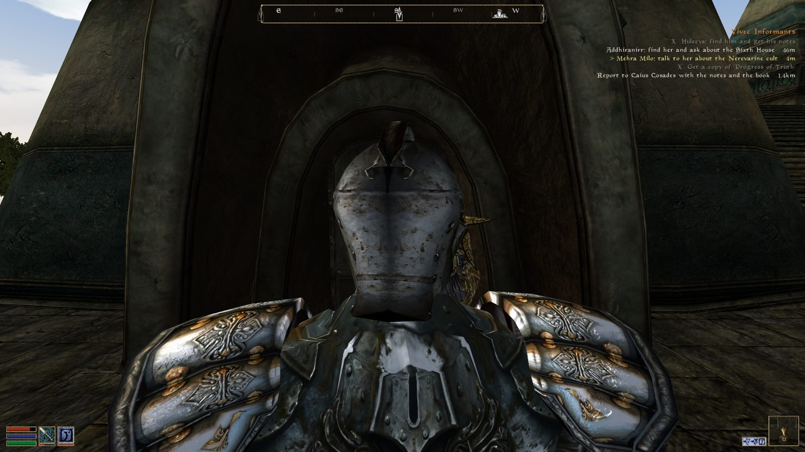
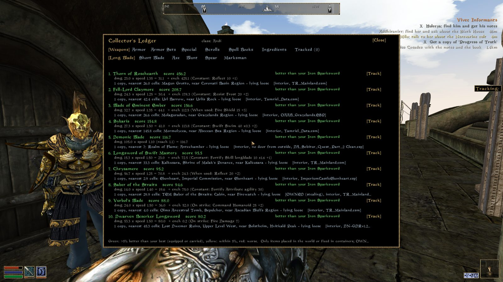

# Comprehensive Objective Mod (OpenMW)

Skyrim-style quest objectives for **OpenMW 0.51**. For every journal stage it shows what to actually do:
who to talk to, which key or item to get, who to kill and where to go. Each objective has a live distance,
a direction arrow (proximityTool's arrow images; it turns as you turn) and a compass/HUD marker.
The panel shows your newest quest, or the one you track with Quest Markers Plus's journal **track** button.



- A small panel at the top right. Finished steps stay listed with an **X**, and the nearest open step is highlighted.
- Objective lines and markers use the quest's colour.
- Markers go through proximityTool, so they show on its HUD and on a
  Skyrim-style compass (Quest Markers Plus).
- Hand-written objectives for **3,161 quest ids**:
  - Morrowind, Tribunal and Bloodmoon.
  - Tamriel Rebuilt (25.08.12).
  - Project Cyrodiil and Skyrim: Home of the Nords.
  - About 70 quest mods, among them Tel Eurus, Greymarch Dawn, Vivec Expansion, Uvirith's Legacy,
    Rise of House Telvanni, Sotha Sil Expanded and Astrologians Guild.
- **Mod-aware:**
  - When a plugin that rewrites a vanilla quest is loaded, the objectives switch to that version.
  - If a quest's journal text changed in a way we don't know about, the panel falls back to showing the journal
    text, so it never shows wrong steps.
- Runs **alongside** other quest trackers; it does not replace them.

## Collector's Ledger (included)

A permanent "quest" for the best items you can find in the world, either lying loose or in containers. It covers:
weapons by type, armor by slot and full sets, artifacts, rings and amulets, scrolls, spell books and ingredients.
Items are coloured green, yellow or red against your current gear. Enchantments are scored with the game's
formula and weighted by your class. Tracking an item puts the nearest copy on the compass.
The search box at the top filters the current tab by name or effect (e.g. "restore fatigue" lists every
ingredient with it) and searches the whole category, not just the top entries.



## Controls

| Keyboard | Controller | Action |
|---|---|---|
| K | D-pad up | Show/hide the objective panel |
| L | D-pad down | Open/close the Collector's Ledger (D-pad moves, A selects, LB/RB switch tabs, B closes) |

## Install

1. Copy this folder somewhere and add it as a `data=` line in `openmw.cfg`.
2. Add `content=comprehensive_objective_mod.omwscripts`.
3. Requires **proximityTool**. Quest Markers Plus is optional, for the compass.

The shipped `objectives_data.lua` and `ledger_data.lua` were built from the author's load order (about 200
plugins). Quests from plugins you don't have are simply never shown.

## Rebuilding the data for your own load order

`tools/` reads your `openmw.cfg` and the plugins in it:

```bash
cd tools
python3 world.py build            # index every plugin (writes world.pickle, a few minutes)
python3 build_objectives.py       # validate objectives/*.json and write the Lua data
python3 build_ledger.py           # rebuild the Collector's Ledger data
```

Other `world.py` helpers that are useful when writing objectives: `journal <QuestId>`, `talk <QuestId>`,
`where <id>`, `find <text>`, `cell "<cell>"`, `mods <QuestId>`.

## Writing objectives

Objectives live in `objectives/*.json`, one entry per quest id and journal stage. See `objectives/main_quest.json`
for the format. `build_objectives.py` checks every target against the real load order and writes
`objectives/VALIDATION.md`.

Wiki-based objectives were written in our own words from the UESP walkthroughs. Quests from mods without a
wiki were written from the mods' own dialogue and scripts.
